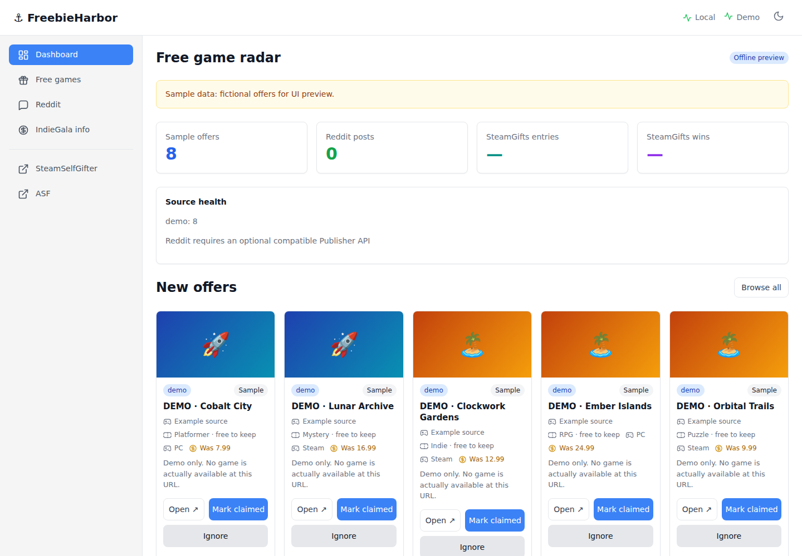

# ⚓ FreebieHarbor

### Your self-hosted free PC games tracker — one dashboard, no accounts to connect.

**Track PC game giveaways, get optional Telegram alerts, and keep your claim history in one place.** FreebieHarbor is an open-source Docker app that collects public free-game offers and stores them locally. Optional read-only adapters show SteamGifts wins and ArchiSteamFarm FreePackages counters.

[](https://github.com/Bl0ck154/FreebieHarbor/actions/workflows/tests.yml)
[](https://github.com/Bl0ck154/FreebieHarbor/releases)
[](LICENSE)
[](https://github.com/users/Bl0ck154/packages/container/package/freebieharbor)

[**Website**](https://bl0ck154.github.io/FreebieHarbor/) · [**Latest release**](https://github.com/Bl0ck154/FreebieHarbor/releases/latest) · [**Install guide**](#quick-start) · [**Help / discussions**](https://github.com/Bl0ck154/FreebieHarbor/discussions)



*Real application screenshot using clearly labeled fictional demo offers.*

## Why FreebieHarbor?

You don't need to check multiple giveaway websites every day. FreebieHarbor periodically checks supported sources, puts offers into a searchable web dashboard and lets you mark them **claimed** or **ignored**.

- **Free games in one feed** — GamerPower, FreeToKeep, GG.deals freebies and best-effort Alienware Arena discoveries.
- **Your history stays local** — SQLite storage, search, source filters, archived history and claimed/ignored states.
- **Fast manual refresh** — clicking Refresh now launches source checks in the background rather than blocking the page.
- **Optional Telegram alerts** — new offers and recorded SteamGifts wins, with deduplication.
- **Optional reward insights** — read-only SteamSelfGifter wins and ASF FreePackages plugin counters from snapshots.
- **No AI tokens, Steam login or paid API** required for the core. No automated contest entries or game claiming.

## Quick start

**Linux amd64 • Docker installed • no source build required.**

```bash
docker volume create freebieharbor-data
docker run -d --name freebieharbor --restart unless-stopped \
  -p 127.0.0.1:18081:8080 \
  -v freebieharbor-data:/data \
  ghcr.io/bl0ck154/freebieharbor:v0.6.0
```

Open **http://127.0.0.1:18081** on the host. For a remote server, connect over SSH:

```bash
ssh -L 18081:127.0.0.1:18081 user@your-server
```

Then open the same address in your local browser. The dashboard is **not authenticated** and deliberately binds to localhost. Don't expose it directly to the public internet.

**Linux arm64 or prefer building from source?** Use Docker Compose instead:

```bash
git clone https://github.com/Bl0ck154/FreebieHarbor.git
cd FreebieHarbor
docker compose up -d
```

To update the prebuilt container, read [upgrade instructions](docs/troubleshooting.md#how-do-i-update-the-prebuilt-docker-container). Use the same `freebieharbor-data` volume to keep your database.

## What is supported?

| Feature | Status | Notes |
| --- | --- | --- |
| GamerPower free game offers | Included | Public API; availability varies |
| FreeToKeep offers | Included | Public API |
| GG.deals freebies | Included | RSS discovery |
| Alienware Arena key drops | Best effort | May block datacenter IPs |
| Offer search, filters and claim status | Included | Local SQLite dashboard |
| Telegram new-offer alerts | Optional | User supplies their own bot token |
| SteamGifts entries and recorded wins | Optional | Read-only SteamSelfGifter SQLite snapshot |
| SteamGifts win alerts | Optional | Requires updated snapshot and Telegram |
| ASF FreePackages counters | Optional | Read-only JSON snapshot; **not** confirmed Steam ownership |

**Limits:** This is a discovery and tracking tool, not an auto-claimer. Offers may expire, run out of keys or be region restricted. No winning probabilities, Steam licenses or rewards are guaranteed. Independent upstream tools are not bundled.

## Configure optional features

The defaults work without creating `.env`. For Docker Compose, copy `.env.example` to `.env` before enabling integrations.

| Environment variable | Purpose |
| --- | --- |
| `POLL_SECONDS` | Source refresh interval (default 1200 seconds, minimum 300) |
| `NOTIFY_NEW_OFFERS` | Enable Telegram alerts for newly found offers |
| `NOTIFY_NEW_WINS` | Enable Telegram alerts for newly recorded SteamGifts wins |
| `TELEGRAM_BOT_TOKEN`, `TELEGRAM_CHAT_ID` | Required only for Telegram |
| `STEAMGIFTS_DB` | Read-only SteamSelfGifter SQLite snapshot inside the container |
| `ASF_PACKAGES_DB` | Read-only FreePackages JSON snapshot inside the container |
| `ALLOWED_HOSTS` | Allowed local/reverse-proxy hostnames |

Telegram alerts establish a silent baseline on the first successful run, so existing offers are not sent as a flood. To mount a snapshot, see [SteamGifts and ASF adapters](docs/architecture.md); **never mount account sessions or ASF's main token database**.

## About the project

FreebieHarbor is a lightweight Python 3.13 application using only the standard library, SQLite and Docker. It is **not affiliated with Valve, SteamGifts, Alienware Arena, GG.deals or the underlying offer providers**. It links to [SteamSelfGifter](https://github.com/kernelcoffee/SteamSelfGifter), [ArchiSteamFarm](https://github.com/JustArchiNET/ArchiSteamFarm) and [FreePackages](https://github.com/Citrinate/FreePackages) as optional independent integrations; their respective licenses apply.

**Friends preview:** [Invitation-only personal dashboards](docs/friends-mode.md) · [Verified Steam identity and one shared ASF](docs/steam-integration.md) (optional separate container; no central Steam login or auto-claim).

**Documentation:** [Server deployments and upstream updates](docs/server-upstream.md) · [Friends-mode design](docs/friends-mode.md) · [How it works](docs/architecture.md) · [Troubleshooting](docs/troubleshooting.md) · [Security](SECURITY.md) · [Contributing](CONTRIBUTING.md) · [Changelog](CHANGELOG.md) · [Third-party credits](THIRD_PARTY.md)

**Developers:** `python3 -m unittest discover -s tests -v` runs the offline regression tests. [Try a fictional, offline demo](docs/troubleshooting.md#how-do-i-run-a-fully-offline-preview) without an account or network polling.

MIT licensed. Questions, bug reports and feature discussions are welcome via [GitHub Discussions](https://github.com/Bl0ck154/FreebieHarbor/discussions) and [Issues](https://github.com/Bl0ck154/FreebieHarbor/issues).
